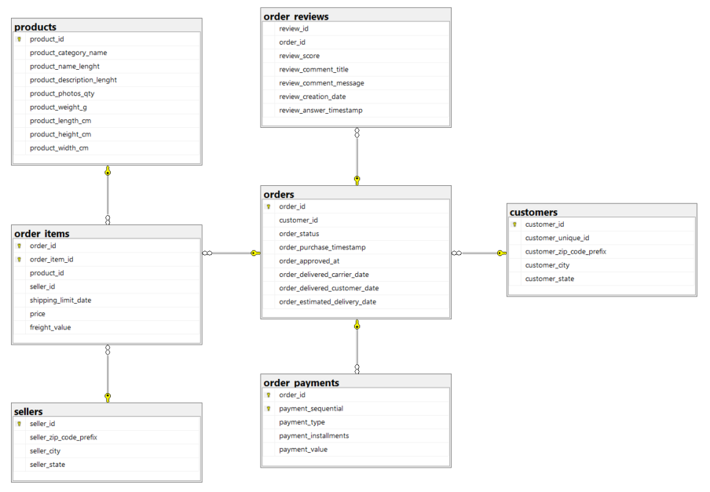
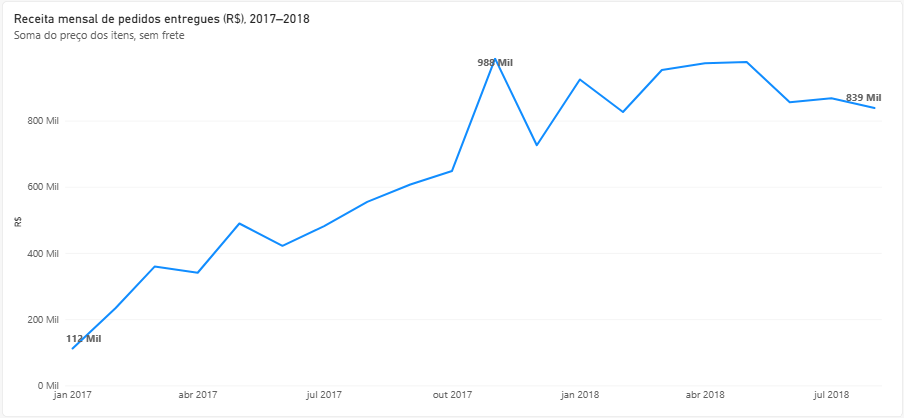
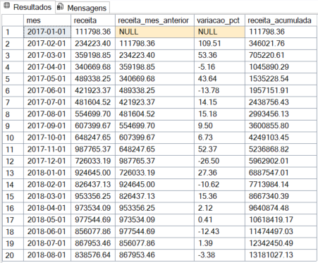
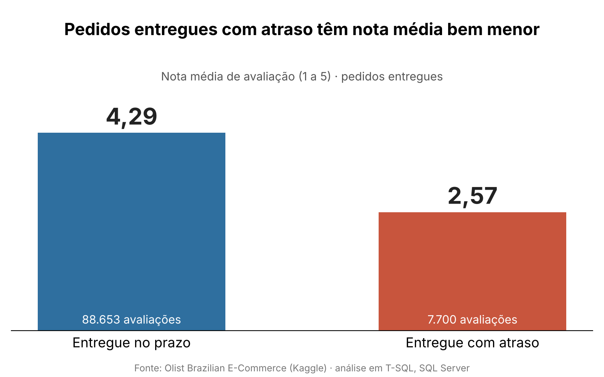
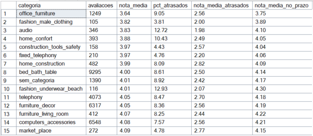
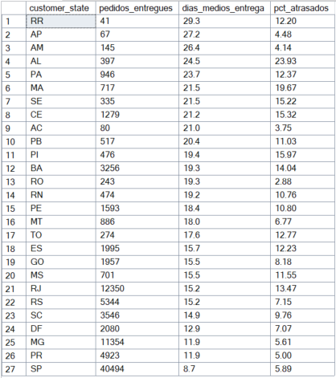

# Análise de e-commerce com SQL Server (Olist)

Projeto de análise de dados com **T-SQL (SQL Server)** sobre vendas de e-commerce no Brasil. A partir de arquivos CSV, montei o banco, defini as relações entre as tabelas e respondi perguntas de negócio sobre receita, pagamentos, entrega, recompra e satisfação dos clientes.

## Dados

- **Fonte:** *Brazilian E-Commerce Public Dataset by Olist*, (https://www.kaggle.com/datasets/olistbr/brazilian-ecommerce), disponível no Kaggle.
- **Conteúdo:** cerca de 99 mil pedidos feitos entre setembro de 2016 e outubro de 2018 em marketplaces brasileiros, com clientes, itens, pagamentos, avaliações, produtos e vendedores. Os dados são anonimizados.
- Os CSVs **não estão** neste repositório. Para reproduzir, baixe-os na página do dataset.
- A tabela `geolocation` (mais de 1 milhão de linhas) não foi usada: as perguntas deste projeto precisam apenas de estado e cidade, que já estão em `customers` e `sellers`.

## Ferramentas

SQL Server (T-SQL), SQL Server Management Studio (SSMS) e Power BI Desktop, usado apenas para o gráfico de receita mensal.

## Modelo de dados

São 8 tabelas: `customers`, `orders`, `order_items`, `order_payments`, `order_reviews`, `products`, `sellers` e `category_translation`.



Um cliente pode ter vários pedidos, e um pedido tem vários itens, pagamentos e (às vezes) avaliações. Os itens ligam o pedido a um produto e a um vendedor. Algumas decisões de modelagem:

- `order_items` e `order_payments` têm chave primária composta (`order_id` + número do item ou do pagamento).
- `order_reviews` não tem chave primária, porque `review_id` se repete na base.
- `category_translation` não tem chave estrangeira com `products`: existem categorias de produtos sem tradução, e a chave bloquearia o relacionamento.
- Os nomes `product_name_lenght` e `product_description_lenght` estão escritos assim no dataset original e foram mantidos.

## Como o banco foi montado

1. Criei o banco `Olist` e importei os CSVs pelo assistente *Importar Arquivo Simples* do SSMS.
2. Conferi as importações: contagem de linhas de cada tabela, soma dos preços dos itens (R$ 13.591.643,70) e intervalo de datas (09/2016 a 10/2018).
3. Defini as chaves primárias e estrangeiras (`sql/01_schema.sql`).

Durante a importação, encontrei quatro problemas, todos resolvidos:

- **Preços 100 vezes maiores.** O assistente usa a configuração regional do Windows, em que o ponto é separador de milhar, e leu `58.90` como `5890`. Importei `price`, `freight_value` e `payment_value` como texto e converti para `DECIMAL(10,2)` depois. A soma total e os primeiros valores confirmaram a correção.
- **Cabeçalho lido como dado** em `category_translation`: removi a linha e renomeei as colunas (`sql/00_corrigir_category_translation.sql`).
- **Tipos numéricos de `products`:** o peso passava do limite de `SMALLINT` e várias colunas tinham valores vazios. Usei `INT` com valores nulos permitidos.
- **CEPs** importados como texto, para não perder o zero à esquerda.

## Perguntas respondidas

Definição usada para **receita**: soma de `price` dos itens de pedidos com status `delivered`, sem o frete. **Atraso**: entrega depois da data estimada.

### 1. Como está a distribuição dos pedidos e dos pagamentos?
*(`sql/02_consultas_basicas.sql`)*

- 96.478 dos 99.441 pedidos (97%) foram entregues. Houve 625 cancelamentos e 609 pedidos indisponíveis.
- O cartão de crédito concentra cerca de 78% do valor pago (R$ 12,5 milhões de R$ 16,0 milhões), e o boleto cerca de 18%.
- 77% das avaliações são notas 4 ou 5, mas 11,5% são nota 1.

### 2. Como evoluiu a receita mensal?
*(`sql/04_funcoes_de_janela.sql`, com `LAG` e soma acumulada)*



A receita mensal passou de R$ 111,8 mil em janeiro de 2017 para R$ 987,8 mil em novembro, cerca de 9 vezes mais, possivelmente por sazonalidade de fim de ano. Em 2018, de janeiro a agosto, ficou entre R$ 826 mil e R$ 978 mil, ainda acima do mesmo período de 2017 (agosto de 2018 foi cerca de 51% maior que agosto de 2017), mas sem a aceleração do ano anterior.



A análise começa em 2017: em 2016 há só 3 meses com pouquíssimos pedidos, e a variação percentual entre eles não tem significado.

### 3. Quais categorias geram mais receita?
*(`sql/03_joins_subqueries_ctes.sql`)*

Em receita, lideram `health_beauty` (R$ 1,23 milhão), `watches_gifts` (R$ 1,17 milhão) e `bed_bath_table` (R$ 1,02 milhão). O ranking de receita não é o de volume: `watches_gifts` vendeu bem menos itens que `bed_bath_table`, mas tem preço médio mais que o dobro (cerca de R$ 199 contra R$ 93).

### 4. Os clientes voltam a comprar?
Só 3,06% dos clientes (2.924 de cerca de 95,5 mil) compraram mais de uma vez. Para contar pessoas, e não pedidos, usei `customer_unique_id`, já que `customer_id` muda a cada pedido.

### 5. Quem lidera as vendas em cada estado?
Usei `RANK() OVER (PARTITION BY ...)` para listar os 3 vendedores que mais faturam em cada estado. O faturamento é concentrado: na Bahia, por exemplo, o primeiro vendedor fatura cerca de R$ 218 mil, e o segundo cerca de R$ 17,5 mil.

### 6. O atraso na entrega afeta a avaliação?
*(`sql/05_categoria_vs_atraso.sql`)*

Pedidos entregues com atraso têm nota média de **2,57**, contra **4,29** nos entregues no prazo, e cerca de 8% dos pedidos avaliados chegaram atrasados.

| Situação da entrega | Avaliações | Nota média |
|---|---|---|
| Atrasado | 7.700 | 2,57 |
| No prazo | 88.653 | 4,29 |



Entre as categorias com menor nota (mínimo de 100 avaliações), `office_furniture` tem a pior média (3,64). Ela atrasa um pouco acima da média geral (9,05%), mas, mesmo nos pedidos entregues no prazo, sua nota (3,75) é a menor entre as 15 categorias da tabela. Ou seja, o atraso, sozinho, não explica a avaliação dessa categoria.



### 7. Como a entrega varia entre os estados?
*(`sql/03_joins_subqueries_ctes.sql`)*

São Paulo concentra cerca de 42% dos pedidos entregues e tem o menor prazo médio (8,7 dias). Os estados do Norte têm os prazos mais longos (acima de 26 dias em RR, AP e AM), mas atrasam relativamente pouco, o que sugere prazos estimados mais longos nessas regiões. Os maiores percentuais de atraso estão no Nordeste, com destaque para Alagoas (23,9%).



## Técnicas de SQL utilizadas

`JOIN` e `LEFT JOIN` entre várias tabelas, `GROUP BY` e `HAVING`, subqueries, CTEs, `CASE WHEN`, `COALESCE`, funções de data (`DATEDIFF`, `DATEFROMPARTS`) e funções de janela (`LAG`, `RANK`, soma acumulada).

## Limitações

- Os dados são históricos (2016 a 2018) e não representam o mercado atual.
- Os resultados mostram associação, não causa. A relação entre atraso e nota baixa, por exemplo, não prova que um causa o outro.
- Estados e categorias com poucos pedidos (como RR, AP e AC, ou `fashion_male_clothing`) têm médias pouco confiáveis.
- A análise de categoria e atraso usa só pedidos entregues e avaliados, por isso os números diferem um pouco de outras consultas.
- A receita não inclui frete, e o prazo de entrega depende da estimativa feita pela plataforma.
- Os 1.390 pedidos de produtos sem categoria aparecem como `sem_categoria`.

## Como reproduzir

1. Baixe o dataset no Kaggle e extraia os CSVs.
2. Crie o banco `Olist` no SQL Server.
3. Importe cada CSV com **Tarefas → Importar Arquivo Simples** (SSMS), usando os nomes de tabela listados acima. Importe `price`, `freight_value` e `payment_value` como texto.
4. Converta os valores monetários para `DECIMAL(10,2)`:
   ```sql
   ALTER TABLE dbo.order_items    ALTER COLUMN price         DECIMAL(10,2) NOT NULL;
   ALTER TABLE dbo.order_items    ALTER COLUMN freight_value DECIMAL(10,2) NOT NULL;
   ALTER TABLE dbo.order_payments ALTER COLUMN payment_value DECIMAL(10,2) NOT NULL;
   ```
5. Execute os scripts da pasta `sql/` em ordem numérica (o `00` só é necessário se o cabeçalho de `category_translation` tiver sido importado como dado).

## Estrutura do repositório

```
sql/
  00_corrigir_category_translation.sql
  01_schema.sql
  02_consultas_basicas.sql
  03_joins_subqueries_ctes.sql
  04_funcoes_de_janela.sql
  05_categoria_vs_atraso.sql
docs/
  diagrama_er.png
  resultados/
    receita_mensal.png
    receita_mensal_tabela.png
    categoria_vs_atraso.png
    entrega_por_estado.png
```

## O que aprendi

A parte que mais me ensinou foi a importação: percebi, ao conferir os valores, que os preços tinham sido lidos 100 vezes maiores por causa da configuração regional, e aprendi a validar os dados (contagens, somas e datas) antes de analisar. Também aprendi a escolher bem os tipos de dados e a verificar se uma consulta com vários `JOIN` não está duplicando linhas, como no caso das avaliações por categoria.
